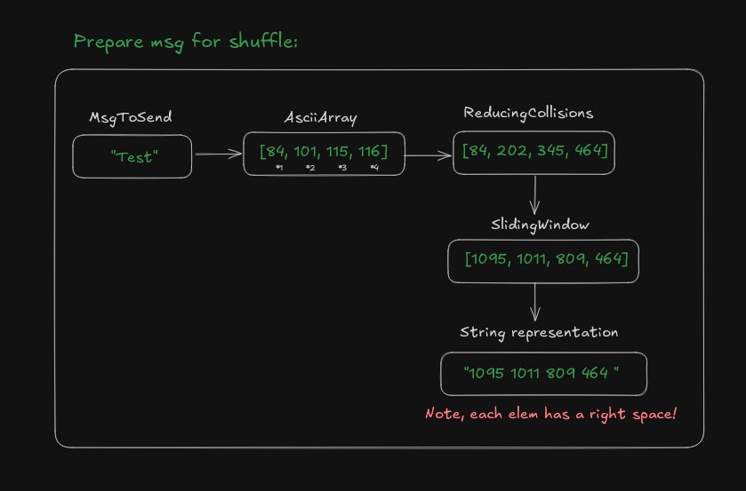
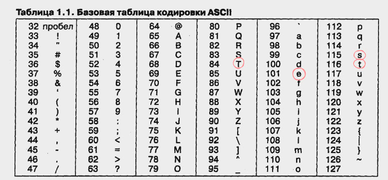
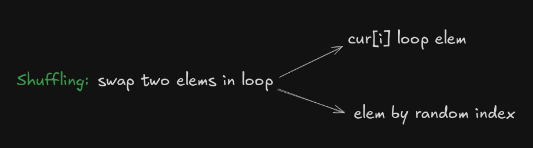
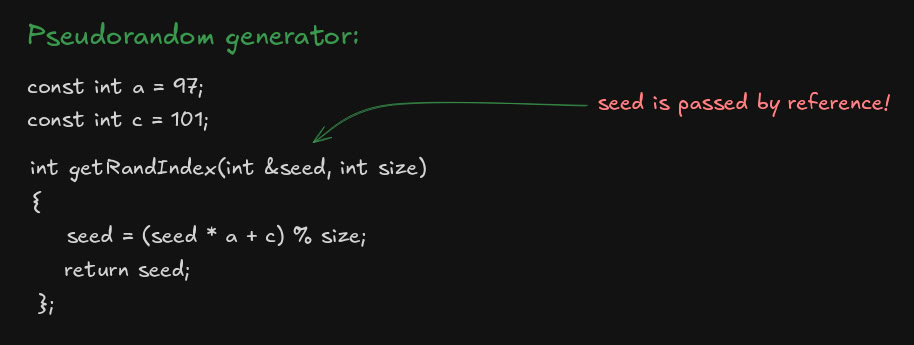
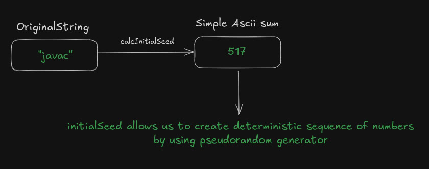
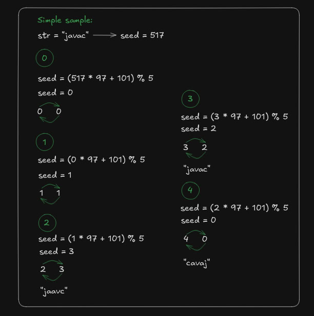
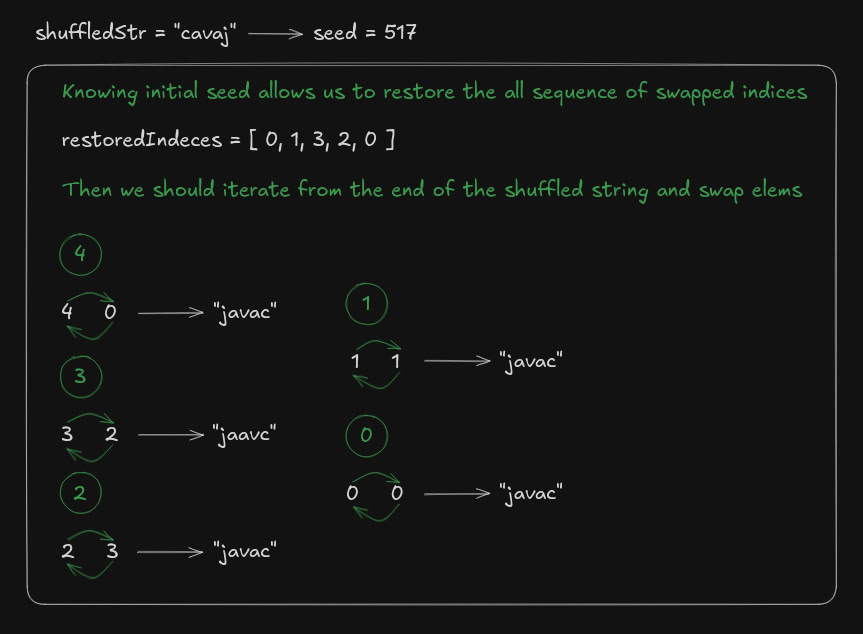

## Алгоритм для шифрования и дешифрования данных без использования хэширования

Данный алгоритм будет состоять из двух этапов - шифрования и перемешивания

Нанчем с этапа шифрования исходного сообщения



Предположим, что передается сообщение "Test"

В первую очередь преобразуем каждый элемент в целое число, само значение возьмем из ASCII таблицы



Полученное значение домножим на индекс + 1, чтобы для одинаковых символов получать разный код

Далее к каждому элементу прибавим сумму соседей справа и полученный массив представим в виде строки, где каждый элемент будет разделен пробелом

Полученное сообщение и будет зашифрованным сообщением, которое далее перемешаем

### Этап перемешивания

Теперь рассмотрим отдельно метод перемешивания



Основная идея данного метода заключается в простом обходе строки в цикле, где каждый i-ый элемент, то есть элемент текущей итерации будем менять с элементом по рандомно сгенерированному индексу

Для генерации рандомного индекса напишем кастомный генератор псевдослучайных чисел, который будет выглядеть следующим образом

```
Для лучшего понимания, что такое псевдорандом и настоящий рандом, рекомендую ознакомиться с подробным разбором от Дмитрия Полевого

https://youtu.be/1NXPf6Loshc?si=vC34y6zQxIabC2LS
```



Обратите внимание, что параметр seed передается по ссылке, это необходимо для того, чтобы в цикле генерировать предсказуемую последовательность, то есть зная начальный seed и число итераций (в данном случае size- т.к. число итераций равно размеру строки) мы можем получать одинаковые последовательности 

Для получения начального seed просто посчитаем сумму ascii символов, такой подход позволит получать одинаковый seed для оригинальной и перемешанной строки



Рассмотрим пример с перемешиванием строки



Предположим что передается строка javac

Начальный seed, полученный как ascii сумма равен 517

На нулевой итерации алгоритма получим seed = 0, то есть нулевой элемент меняем с нулевым

На первой итерации опять получаем seed равный номеру итерации 

На второй итерации получаем seed равный трем и меняем элемент по текущему индексу с третьим 

Продолжаем итерироваться по всей строке и по итогу получаем перемешанную строку "cavaj"

**Теперь вернем перемешанную строку к исходному состоянию**

Строка "cavaj" даст тот же начальный seed и размер что исходная



Зная значение начального seed восстановим всю последовательность сгенерированных индексов, сами индексы запишем в массив

Далее необходимо проитерироваться с конца строки, восстанавливая индексы в обратном порядке, как это показано на примере

Соединим оба этапа и реализуем всю логику в классе

```c++
#ifndef CRYPTMANAGER_H
#define CRYPTMANAGER_H

#include <string>
#include <vector>

#define A_PARAM 97
#define C_PARAM 101

class CryptManager
{
public:
    CryptManager() = default;
    ~CryptManager() = default;

    /// копирование и перемещение не нужны
    CryptManager(const CryptManager&) = delete;
    CryptManager(CryptManager&&) = delete;
    CryptManager& operator=(const CryptManager&) = delete;
    CryptManager& operator=(CryptManager&&) = delete;

    std::string code(const std::string &msg);
    std::string decode(const std::string &msg);

private:
    /// Для шифрования
    std::vector<int> makeAsciiArray(const std::string &msg);
    void addSumOfRightElems(std::vector<int> &asciiArray);
    std::string convertArrayToString(const std::vector<int> &array);
    std::string shuffle(const std::string &cryptedMsg);

    /// Общие методы
    int calcSeed(const std::string &msg);
    int getRandIndex(int &seed, int size);

    /// Дешифрование
    std::string restoreOrder(const std::string &shuffledStr);
    std::vector<int> arrayFromStingArray(const std::string &stringArray);
    void removeSumOfRightElems(std::vector<int> &nums);
    void removeIndexMultiply(std::vector<int> &nums);
    std::string makeStrFromAsciiArray(const std::vector<int> &asciiArray);
};

#endif // CRYPTMANAGER_H
```

```c++
#include "cryptmanager.h"
#include <sstream>

std::string CryptManager::code(const std::string &msg)
{
    if (msg.size() <= 0) return std::string();

    std::vector<int> asciiArray = makeAsciiArray(msg);
    addSumOfRightElems(asciiArray);

    std::string cryptedStr = convertArrayToString(asciiArray);
    return shuffle(cryptedStr);
}

std::string CryptManager::decode(const std::string &msg)
{
    if (msg.size() <= 0) return std::string();

    std::string restoredOrderStr = restoreOrder(msg);
    std::vector<int> nums = arrayFromStingArray(restoredOrderStr);

    removeSumOfRightElems(nums);
    removeIndexMultiply(nums);

    return makeStrFromAsciiArray(nums);
}

std::vector<int> CryptManager::makeAsciiArray(const std::string &msg)
{
    std::vector<int> asciiArray;
    for (int i = 0; i < msg.size(); ++i) {
        asciiArray.push_back(static_cast<int>(msg[i]) * (i + 1));
    }

    return asciiArray;
}

void CryptManager::addSumOfRightElems(std::vector<int> &asciiArray)
{
    int sum = 0;
    for (int i = 1; i < asciiArray.size(); ++i) {
        sum += asciiArray[i];
    }

    for (int i = 0; i < asciiArray.size() - 1; ++i) {
        asciiArray[i] += sum;
        sum -= asciiArray[i + 1];
    }
}

std::string CryptManager::convertArrayToString(const std::vector<int> &array)
{
    std::string res;
    for (int i = 0; i < array.size(); ++i) {
        res += std::to_string(array[i]) + " ";
    }

    return res;
}

std::string CryptManager::shuffle(const std::string &cryptedMsg)
{
    int initialSeed = calcSeed(cryptedMsg);

    std::string shuffledStr = cryptedMsg;
    int size = shuffledStr.size();

    for (int i = 0; i < size; ++i) {
        int indexToSwap = getRandIndex(initialSeed, size);
        std::swap(shuffledStr[i], shuffledStr[indexToSwap]);
    }

    return shuffledStr;
}

int CryptManager::calcSeed(const std::string &msg)
{
    int seed = 0;
    for (int i = 0; i < msg.size(); ++i) {
        seed += static_cast<int>(msg[i]);
    }

    return seed;
}

int CryptManager::getRandIndex(int &seed, int size)
{
    seed = (seed * A_PARAM + C_PARAM) % size;
    return seed;
}

std::string CryptManager::restoreOrder(const std::string &shuffledStr)
{
    int initialSeed = calcSeed(shuffledStr);

    std::string restoredOrderStr = shuffledStr;
    int size = restoredOrderStr.size();

    std::vector<int> swappedIndices(size);
    for (int i = 0; i < size; ++i) {
        swappedIndices[i] = getRandIndex(initialSeed, size);
    }

    for (int i = size - 1; i >= 0; --i) {
        std::swap(restoredOrderStr[i], restoredOrderStr[swappedIndices[i]]);
    }

    return restoredOrderStr;
}

std::vector<int> CryptManager::arrayFromStingArray(const std::string &stringArray)
{
    std::vector<int> nums;

    std::stringstream ss(stringArray);
    int num;

    while (ss >> num) {
        nums.push_back(num);
    }

    return nums;
}

void CryptManager::removeSumOfRightElems(std::vector<int> &nums)
{
    for (int i = 0; i < nums.size() - 1; ++i) {
        nums[i] -= nums[i + 1];
    }
}

void CryptManager::removeIndexMultiply(std::vector<int> &nums)
{
    for (int i = 1; i < nums.size(); ++i) {
        nums[i] /= (i + 1);
    }
}

std::string CryptManager::makeStrFromAsciiArray(const std::vector<int> &asciiArray)
{
    std::string res;

    for (int code : asciiArray) {
        res.push_back(static_cast<char>(code));
    }

    return res;
}
```

```c++
#include "cryptmanager.h"
#include <iostream>

using namespace std;

int main()
{
    string msg = "MyTestMsg";
    cout << "Original msg: " << msg << endl;

    CryptManager manager;

    string coded = manager.code(msg);
    cout << "\n" << "Crypted msg: " << coded << endl;

    string decoced = manager.decode(coded);
    cout << "\n" << "Decoded msg: " << decoced << endl;

    return 0;
}
```

И получаем ожидаемый вывод
```c++
Original msg: MyTestMsg

Crypted msg: 960 5641035 8  724284232  738473 3 5165 3614

Decoded msg: MyTestMsg
```