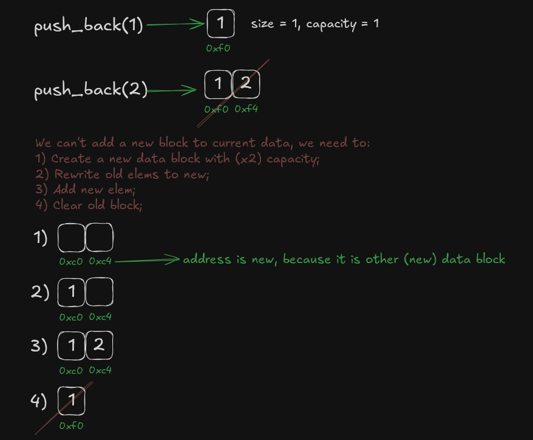

## Ускоряем массив одной строчкой

В сегодняшней статье разберем способ оптимизировать работу вектора, используя встроенный метод `reserve`, но прежде чем приступать к данному разбору, рекомендую ознакомиться с подробным разбором внутреннего устройства вектора от Владимира Балуна: https://youtu.be/hAfX4IA8LVo?si=c8v1959XcTIWrCl3

В данной статье будет использоваться библиотека `google benchmark`
https://github.com/google/benchmark

Перейдем сразу к бенчмаркам

Первый метод создает вектор и в цикле на 100 итераций добавляет элемент в созданный вектор

Второй метод выполняет тоже самое, но с предварительной аллокацией памяти под 100 элементов

```c++
#include <iostream>
#include <vector>
#include <benchmark/benchmark.h>

static void BM_NoReserve(benchmark::State& state)
{
   for (auto _ : state) {
       std::vector<int> v;
       for (int i = 0; i < 100; ++i) {
           v.push_back(i);
       }
   }
}
BENCHMARK(BM_NoReserve);

static void BM_WithReserve(benchmark::State& state)
{
   for (auto _ : state) {
       std::vector<int> v;
       v.reserve(100);
       for (int i = 0; i < 100; ++i) {
           v.push_back(i);
       }
   }
}
BENCHMARK(BM_WithReserve);

BENCHMARK_MAIN();
```

Запускаем и получаем следующий результат
```
---------------------------------------------------------
Benchmark               Time             CPU   Iterations
---------------------------------------------------------
BM_NoReserve         1700 ns         1700 ns       426397
BM_WithReserve        745 ns          745 ns       941256
```

Метод без reserve отработал за 1700 наносекунд, в то время как с reserve за 745, то есть предварительная аллокация памяти ускорила работу в 2 раза, теперь разберемся почему так происходит

Добавим отладочный вывод вместимости вектора (то есть аллоцированной памяти) на каждой итерации, причем число итераций уменьшим до 10, чтобы не получать огромный лог

```c++
vector<int> v;
for (int i = 0; i < 10; ++i) {
    cout << "Итерация:" << i << endl;

    int oldCapacity = v.capacity();
    cout << "До push_back:" << v.capacity() << endl;

    v.push_back(i);
    int newCapacity = v.capacity();
    cout << "После push_back:" << v.capacity() << endl;

    if (oldCapacity != newCapacity)
        cout << "Реаллокация!" << endl;
}
```
Запускаем и видим следующий вывод (вывод отредактирован вручную в таблицу для более удобного восприятия)
```
Итерация     До push_back   После push_back    Реаллокация?
-------------------------------------------------------
0            0              1                  Реаллокация! (0 → 1)
1            1              2                  Реаллокация! (1 → 2)
2            2              4                  Реаллокация! (2 → 4)
3            4              4                  Нет
4            4              8                  Реаллокация! (4 → 8)
5            8              8                  Нет
6            8              8                  Нет
7            8              8                  Нет
8            8              16                 Реаллокация! (8 → 16)
9            16             16                 Нет
```

Размер вектора (то есть количество элементов) и его вместимость (то есть выделенная под элементы память) по умолчанию равны нулю, т.к. вектор пуст

На нулевой итерации, для того чтобы записать в пустой вектор значение, сначала необходимо выделить под него память и уже после записать добавляемый элемент, после добавления элемента текущий размер вектора и вместимость равны одному

На следующей итерации пытаемся добавить второй элемент, но текущая вместимость равна 1, а значит необходимо:


- выделить новый кусок памяти с x2 от текущей вместимости, т.к. невозможно в текущую память добавить последовательно еще один блок
- перезаписать в новый кусок памяти все значения из предыдущего
- добавить новый элемент
- очистить предыдущий кусок памяти

То есть добавление элемента в уже заполненной вектор ведет к накладным расходам именно из-за переаллокаций памяти, т.к. если текущей вместимости не хватает, вектор создает новый кусок памяти с удвоенной вместимостью и перезаписывает в него предыдущие элементы

Таким образом без `reserve` мы получаем количество переаллокаций памяти равное логарифму количества добавлений + 1, т.к. на первой итерации вектор пуст

В нашем примере количество добавлений равно 10, логарифм от 10 равен 4 (округляем в большую сторону) и добавляем единицу, то есть 5 переаллокаций памяти, что соответствет выводу.

Теперь добавим предварительный reserve
```c++
vector<int> v;
v.reserve(10);
for (int i = 0; i < 10; ++i) {
    cout << "Итерация:" << i << endl;

    int oldCapacity = v.capacity();
    cout << "До push_back:" << v.capacity() << endl;

    v.push_back(i);
    int newCapacity = v.capacity();
    cout << "После push_back:" << v.capacity() << endl;

    if (oldCapacity != newCapacity)
        cout << "Реаллокация!" << endl;
}
```

```
+----------+----------------+------------------+-----------------------------------+
| Итерация | До push_back   | После push_back   | Результат                                      |
+----------+----------------+------------------+-----------------------------------+
| 0        | 10             | 10               | ❌ Нет реаллокации |
| 1        | 10             | 10               | ❌ Нет реаллокации |
| 2        | 10             | 10               | ❌ Нет реаллокации |
| 3        | 10             | 10               | ❌ Нет реаллокации |
| 4        | 10             | 10               | ❌ Нет реаллокации |
| 5        | 10             | 10               | ❌ Нет реаллокации |
| 6        | 10             | 10               | ❌ Нет реаллокации |
| 7        | 10             | 10               | ❌ Нет реаллокации |
| 8        | 10             | 10               | ❌ Нет реаллокации |
| 9        | 10             | 10               | ❌ Нет реаллокации |
+----------+----------------+------------------+-----------------------------------+
```

Как видно из лога предварительный reserve убрал переаллокации памяти и ведущие за этим накладные расходы