### Метод анализа иерархий Томаса Саати

В сегодняшней статье разберем математический инструмент под названием: "Метод анализа иерархий Томаса Саати"

Данный инструмент широко используется в управленческой практике, когда из множества систем необходимо выбрать наилучшую, опираясь на заданные критерии

Рассмотрим следующий пример:

Опираясь на резюме и выполненное тестовое задание HR необходимо выбрать кандидата для приглашения на следующую секцию

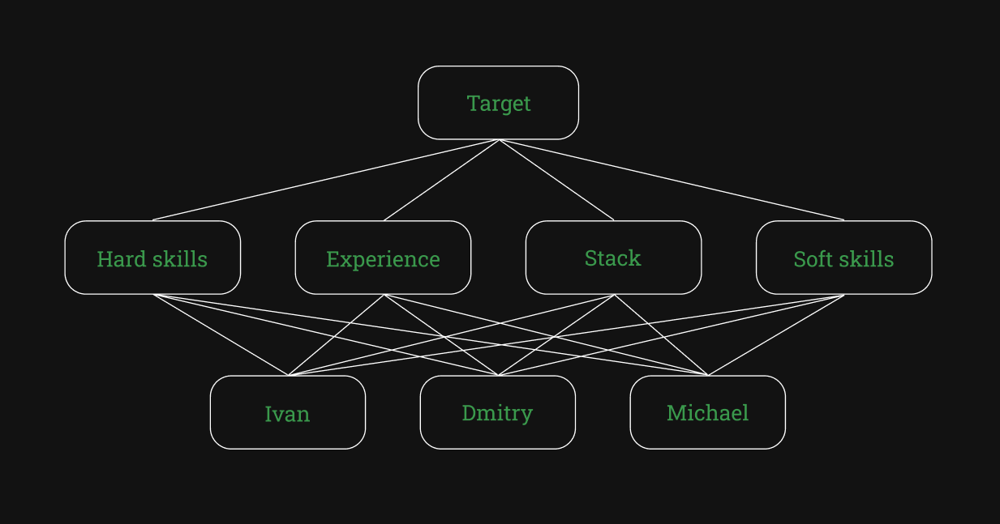

Целью в данном случае является наилучший кандидат

Критерии оценивания:
- хард скиллы
- опыт
- стек
- софт скиллы

Кандидаты: 
- Иван
- Дмитрий
- Михаил

Для определения веса каждого критерия (то есть определения на сколько один критерий важнее другого) строится матрица попарных сравнений 2-го уровня

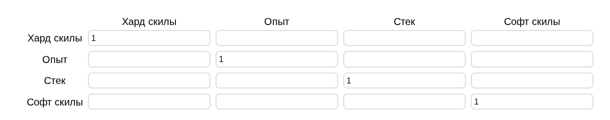

Элемент строки сравнивается с соответствующим элементом столбца, к примеру если эксперт хочет указать, что хард скиллы важнее опыта в два раза он вводит соответствующее значение в первую строку и второй столбец

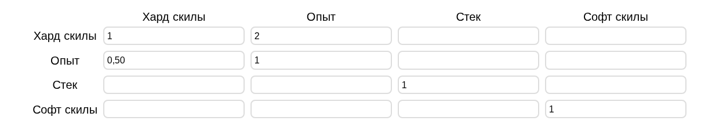

При оценке одной из характеристик происходит расчет обратно симметричного значения, то есть если хард скиллы важнее опыта в два раза, то опыт важнее хард скиллов в 0,5 

Элементы главной диагонали всегда единицы, поскольку отношение характеристики к самой себе всегда дает единицу

После заполнения всей матрицы необходимо рассчитать итоговые оценки

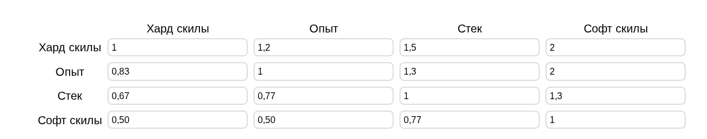

Расчет осуществляется следующим способом

1) Находим произведение по строке и извлекаем корень из n, где n - количество элементов (столбцов), найденное произведение и будет оценкой критерия

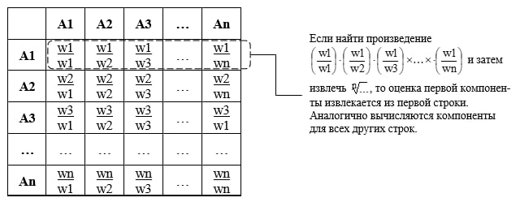

2) Найденные оценки необходимо нормализовать, для этого находим сумму всех оценок и каждую оценку делим на найденную сумму

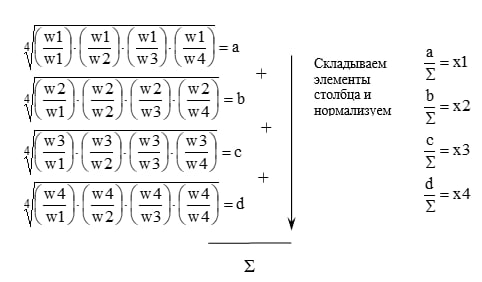

По итогу получаем следующие оценки характеристик

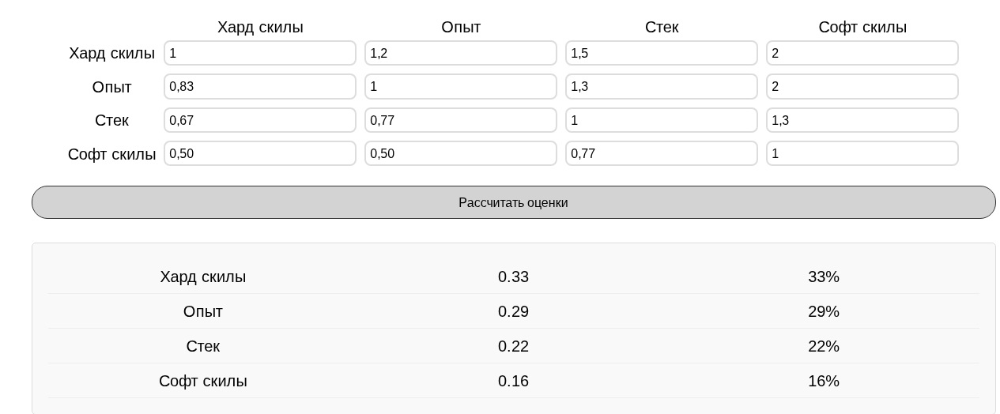

После расчета оценок матрицы 2-го уровня, необходимо построить n-ное количество матриц 3-го уровня, где n это количество характеристик 

В данных матрицах мы сравнивам попарно всех кандидатов по конкретной характеристики, расчеты оценок идентичны

Предположим что кандидат Иван показал себя значительно лучше Дмитрия (в два раза) и в три раза лучше Михаила, а кандидат Дмитрий показал себя в 1,5 раза лучше Михаила, тогда оценки будут выглядеть следующим образом

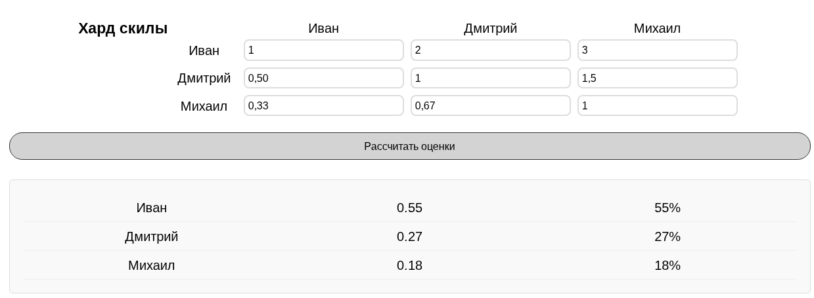

В оставшихся матрицах 3-го уровня эксперт выставил следующие оценки

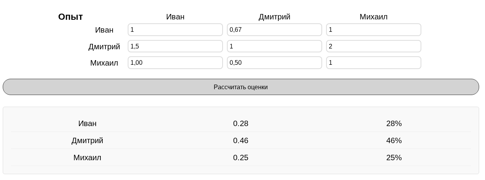
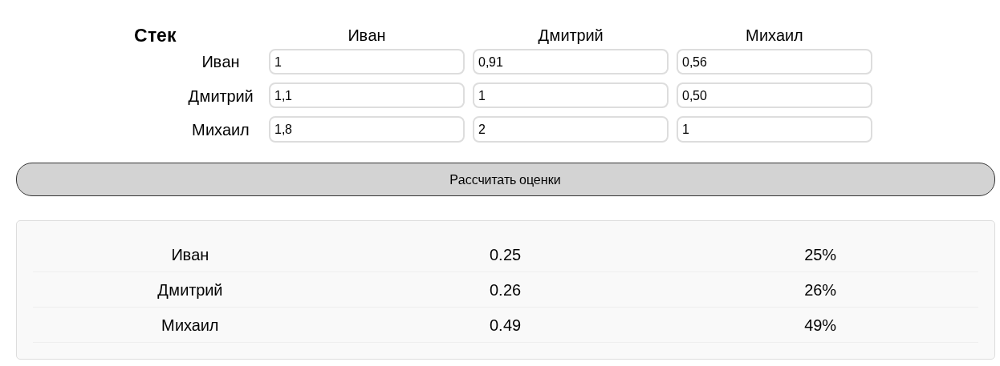
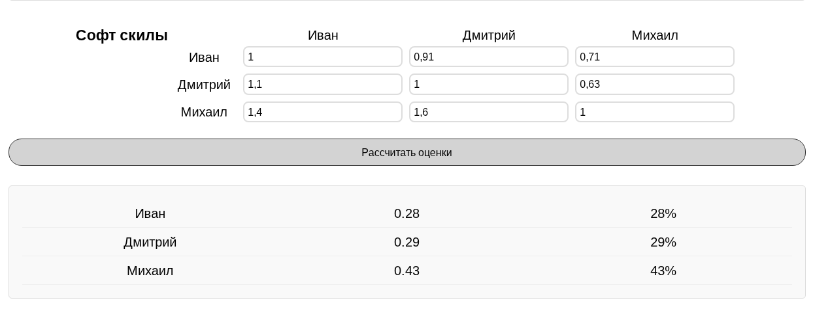

Последний этап - расчет глобальных оценок

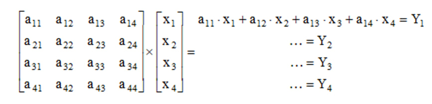

Столбцы a – транспонированные матрицы, полученные после расчета матриц 3-го уровня, компоненты x – это нормализованные оценки матрицы 2-го уровня. Глобальные оценки считаются путем перемножения элементов строки с соответствующими компонентами нормализованных оценок матрицы 2-го уровня (х), произведения суммируются и получаются итоговые оценки.

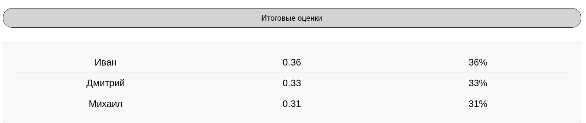

https://glittering-bunny-5062dd.netlify.app/