## Two Sum

Easy задача с `Leetcode`, покрывающая основные темы, а именно:
- хэш таблица
- бинарный поиск
- два указателя

**Постановки задачи**

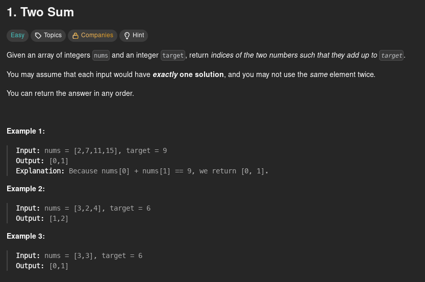

Дан массив целых чисел `nums` и искомое число `target`, необходимо найти индексы двух чисел, дающих в сумме искомое число

Обратите внимание, что массив содержит лишь одно решение и один и тот же элемент нельзя использовать дважды

### Двойной цикл

Начнем с очевидного решения в лоб, а именно двойного цикла, внутри которого проитерируемся по всему массиву, считая сумму `i` и `j` элемента

На каждой итерации считаем сумму текущего элемента с элементом справа

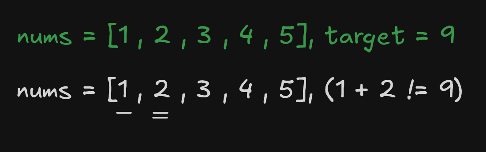

Если сумма не равна искомому значению берем следующий элемент справа и так до тех пор, пока для текущего элемента не закончатся соседи

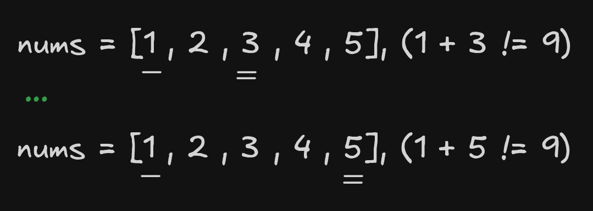

После чего сдвигаем текущий элемент и проверяем уже его соседей справа

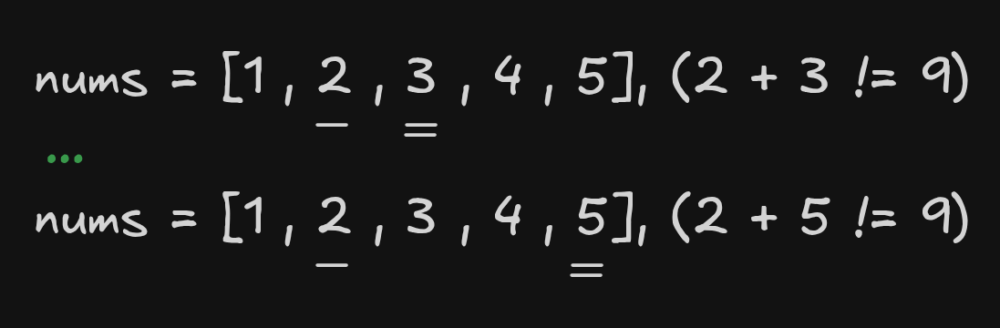

Повторяем до тех пор, пока либо не найдем решения, либо не просмотрим весь массив

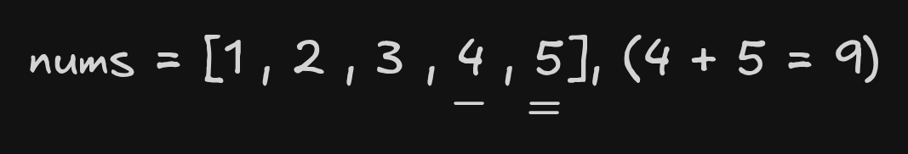

**Напишем решение**

```c++
vector<int> twoSum(vector<int>& nums, int target) {
    for (int i = 0; i < nums.size() - 1; ++i) {
        for (int j = i + 1; j < nums.size(); ++j) {
            if (nums[i] + nums[j] == target)
                return vector<int>{i, j};
        }
    }

    return vector<int>();
}
```

Задача решена и проходит все тест кейсы, но давайте проанализируем решение

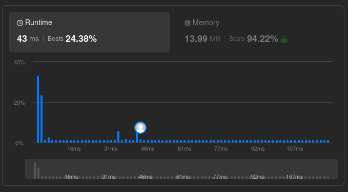

Для оценки алгоритма используются две метрики - это `временная сложность - time complexity` (то есть число итераций) и `пространственная сложность - space complexity` (то есть дополнительная память)

В текущем решении мы работаем напрямую с переданным массивом без введения дополнительных структур, поэтому пространственная сложность константная

Временная сложность показывает плохой результат, поэтому посчитаем требуемое число итераций и для этого вернемся к примеру из начала


При оценке сложности алгоритма используется наихудший случай и данный пример как раз является таковым, поскольку ответ расположен в самом конце и для его нахождения приходится проитерироваться по всему массиву

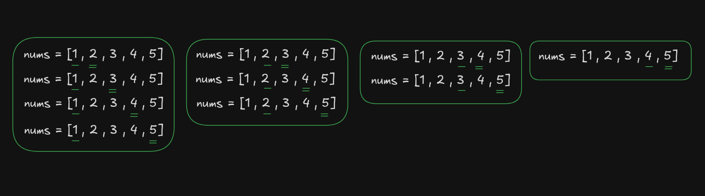

На нулевой итерации необходимо просмотреть все элементы, кроме первого, т.к. складывать элемент с самим собой по условию задачи запрещено, на следующей итерации число проверок уменьшилось на один, т.к. первый элемент уже просмотрен, то есть на каждой итерации число проверок уменьшается на единицу, а изначальное число проверок это размер массива - 1

Итоговая сложность алгоритма - это арифметическая прогрессия, но в `Big-O` нотации константные множители и младшие члены отбрасываются, поэтому сложность считается квадратичной

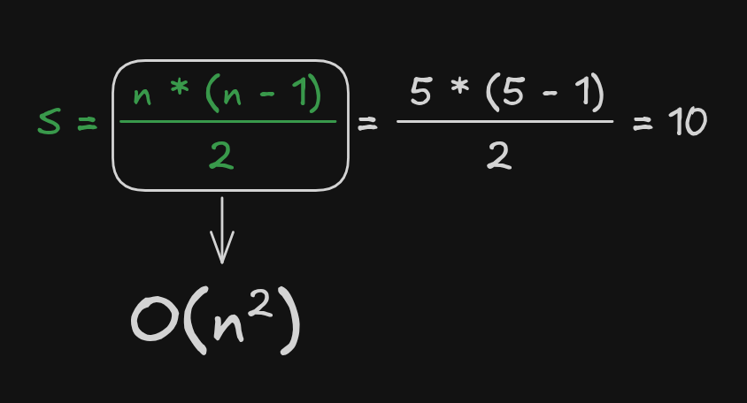

Попробуем оптимизировать алгоритм и для этого ответим на вопрос, можем ли зная элемент текущей итерации сказать какой элемент нужно найти?

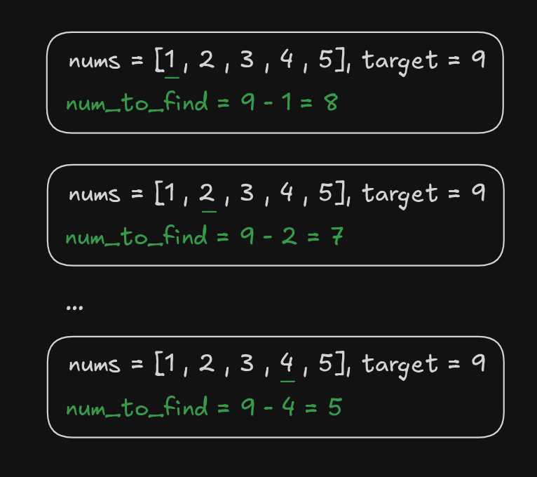

На самом деле можем, к примеру на нулевой итерации текущий элемент это единица, заданный элемент это 9, значит искомый - это 8 и так далее на каждой итерации

Теперь ответим на вопрос, какая структура данных позволяет осуществлять поиск за константное время? Ответ - хэш таблица, рассмотрим по итерациям и для примера скажем что искомое число - это 4

Создаем объект хэш таблицы и заходим в цикл

На нулевой итерации текущее число это единица, заданное 4, значит искомое это 3

Проверяем есть ли в хэш таблице ключ 3, его нет, поэтому добавляем пару ключ значение из элемента текущей итерации и его индекса, число используем в кач-ве ключа, т.к. поиск в хэш таблице осуществляется именно по ключу

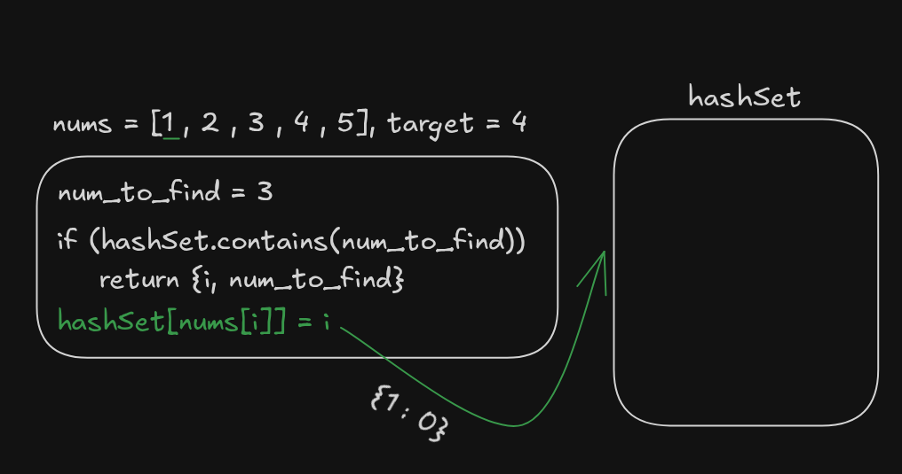

Переходим к следующей итерации 

Текущее число 2, искомое число тоже 2

Нужного числа в хэш таблице нет, поэтому снова записываем элемент текущей итерации

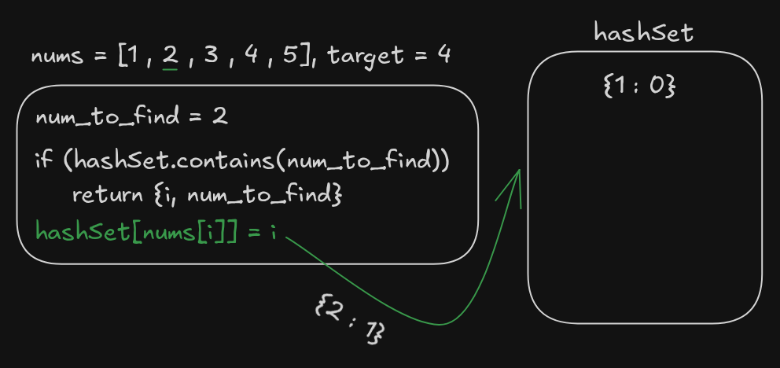

И на третьей итерации мы встречаем нужное число 

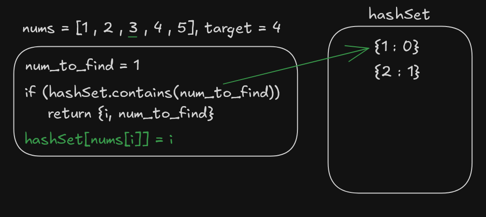

То есть в предыдущей реализации с двойным циклом мы вручную перебирали все элемента справа в поисках нужного, хэш таблица решает эту проблему, т.к. она запоминает все встреченные числа и их индексы и поэтому вместо ручного перебора мы просто спрашиваем у хэш таблицы встречала ли она искомое число, ответ приходит мгновенно за `O(1)`

По итогу получаем, что двойной цикл — «слепой» перебор соседей, а
хэш-таблица — «умный» поиск через память

```c++
vector<int> twoSum(vector<int>& nums, int target) {
    unordered_map<int, int> hashMap;
    for (int i = 0; i < nums.size(); ++i) {
        int numToFind = target - nums[i];
        if (hashMap.find(numToFind) != hashMap.end())
            return {i, hashMap[numToFind]};

        hashMap[nums[i]] = i;
    }

    return {};
}
```

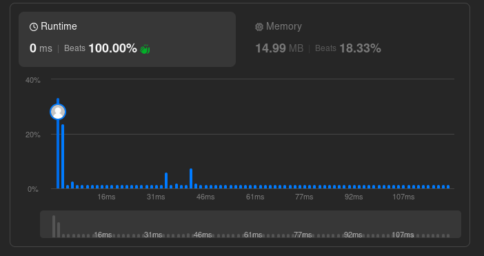

Как видно из вывода мы добились наиболее оптимального решения в плане скорости (временная сложность будет линейной, т.к. нам по прежнему в худшем случае придется проитерироваться по всему массиву), но пришлось внедрить дополнительную память для хранения хэш таблицы и в худшем случае придется добавить в хэш таблицу почти все элементы, поэтому пространственная сложность данного решения линейная

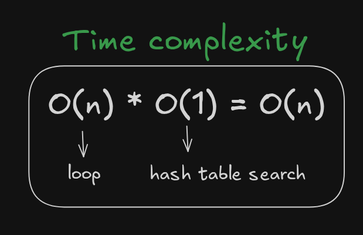

После решения с хэш таблицей меня попросили написать алгоритм оптимизированный по памяти, с уточнением что входной массив отсортирован, что своего рода было подсказкой к решению через бинарный поиск

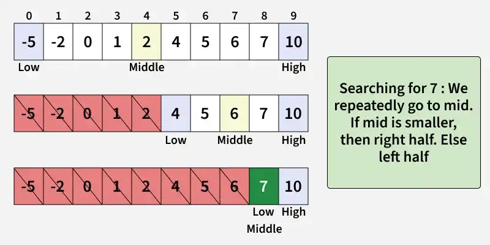

Основная идея бинарного поиска заключается в отсечении половины массива на каждой итерации, к примеру если искомое число 7, необходимо взять элемент посередине от текущей левой и правой границы, это 2, поскольку 2 меньше 7 в левой части массива 7 точно отсутствует, поэтому отсекаем половину массива, сдвинув левую границу Low на текущую середину + 1, после чего снова проверяем элемент посередине от текущих границ и так до тех пор пока не встретим искомое число

```c++
#include <iostream>
#include <vector>
#include <algorithm>

using namespace std;

int binarySearch(vector<int> &nums, int start, int numToFind)
{
    int left  = start + 1;
    int right = nums.size() - 1;

    while (left <= right) {
        int mid = left + (right - left) / 2;

        if (nums[mid] == numToFind)
            return mid;
        else if (nums[mid] < numToFind)
            left = mid + 1;
        else
            right = mid - 1;
    }

    return -1;
};

vector<int> twoSum(vector<int> &nums, int target)
{
    for (int i = 0; i < nums.size(); ++i) {
        int numToFind = target - nums[i];
        int numToFindIndex = binarySearch(nums, i, numToFind);

        if (numToFindIndex != -1)
            return {i, numToFindIndex};
    }

    return {};
};

int main()
{
    vector<int> nums = {1, 2, 3, 4, 5};
    int target = 9;

    vector<int> res = twoSum(nums, target);
    for (int elem : res)
        cout << elem << " ";
    cout << "\n";

    return 0;
}
```

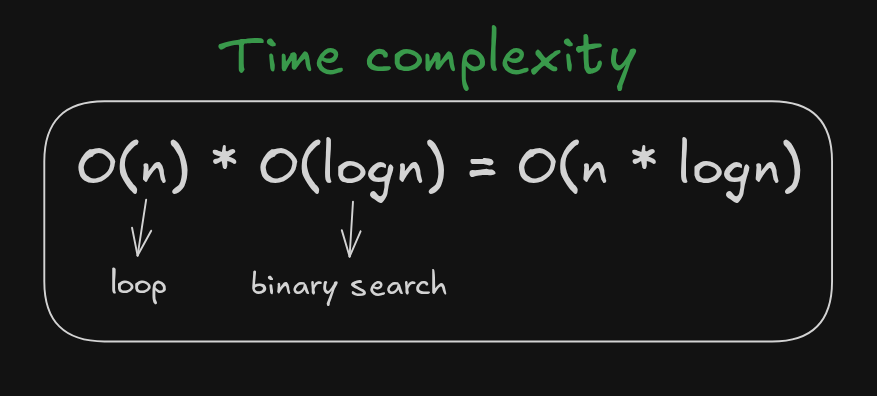

Временная сложность становится `O(n * logN)`, где n - это количество итераций по всему массиву (то есть внешний цикл), а логарифм это сложность бинарного поиска, пространственная сложность становится константной, поскольку дополнительной памяти под структуры не требуется

Однако временную сложность можно улучшить, используя метод двух указателей

Левый указатель указывает на начало массива, правый на конец, считаем сумму левого и правого указателя и в случае если она меньше искомой, сдвигаем левый указатель, таким образом увеличивая сумму, в случае если она больше, сдвигаем правый указатель соответственно уменьшая сумму и так до тех пор пока не получим искомую сумму

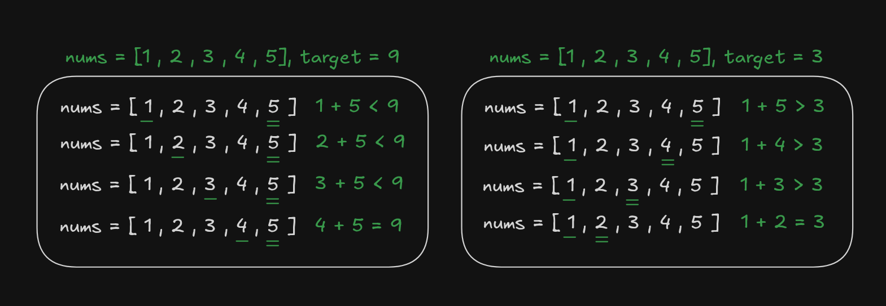

```c++
vector<int> twoSum(vector<int> &nums, int target)
{
    int left = 0;
    int right = nums.size() - 1;

    while (left < right) {
        int sum = nums[left] + nums[right];

        if (sum == target)
            return {left, right};
        else if (sum < target)
            left++;
        else
            right--;
    }

    return {};
}
```

Пространственная сложность по прежнему остается константной, временная сложность становится линейной

Итоговые оценки представлены на слайде:

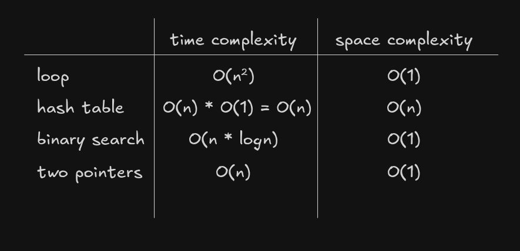
